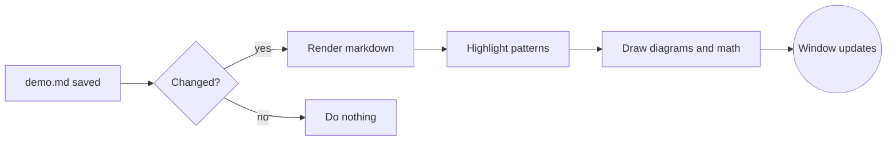
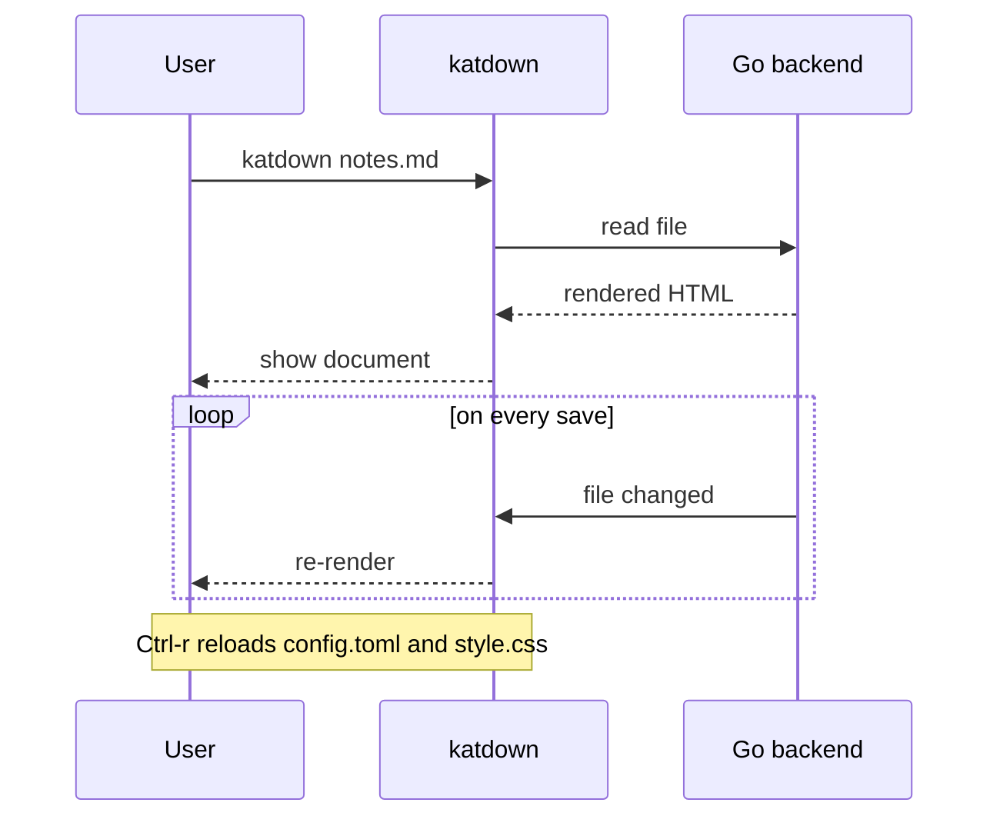
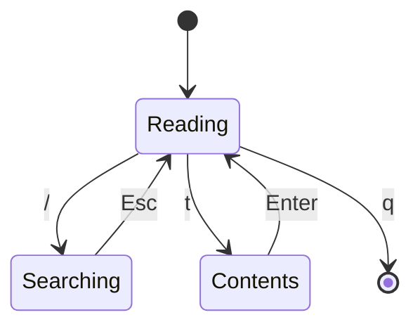
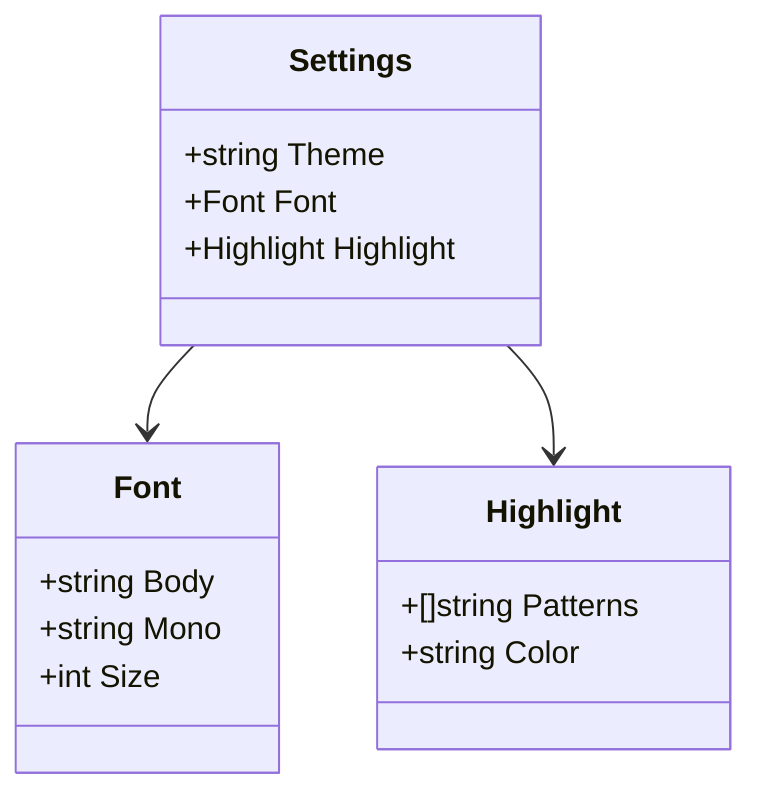
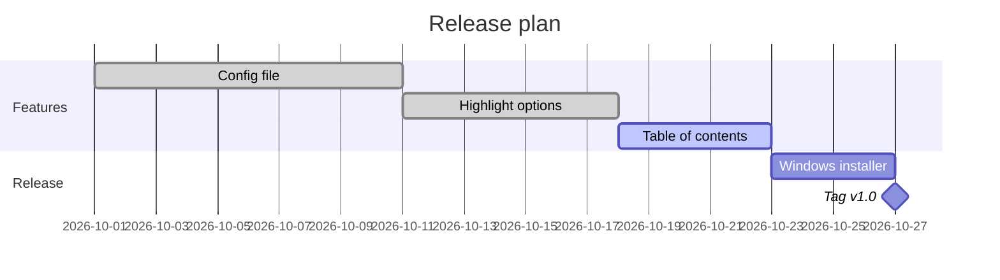
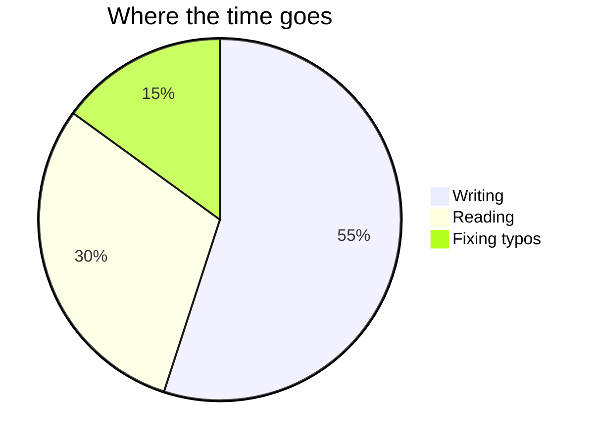

# katdown demo

A tour of everything katdown renders. Open it with `katdown demo.md`, press `t` for the table of contents, `]]` / `[[` to hop between headings, and `?` for the key help.

## Highlighting

With the default settings, anything in curly braces is highlighted: Dear {customer name}, your order {order id} ships on {ship date}.

It works inside other formatting too: **bold {placeholder}**, *italic {placeholder}*, ~~struck {placeholder}~~, and in a [link to {somewhere}](https://example.com).

Some things are never highlighted:

- inline code: `{not highlighted}`
- math: $\{x \mid x > 0\}$
- an escaped brace: \{skipped once} but {this one} still is
- a bare URL: https://example.com/{path}

Add your own patterns in `config.toml`, for example to flag TODO and FIXME:

```toml
[highlight]
patterns = ['\{[^{}]+\}', '\bTODO\b', '\bFIXME\b']
color = "#e0af68"
```

With that config, this line lights up: TODO write the release notes, FIXME the flaky test.

## Mermaid diagrams

Diagrams are drawn offline and take their colors from the stylesheet, so they follow the dark and light themes.

### Flowchart



### Sequence diagram



### State diagram



### Class diagram



### Gantt chart



### Pie chart



## Math

Inline math sits in the text: Euler's identity $e^{i\pi} + 1 = 0$, and the area of a circle is $A = \pi r^2$.

Display math goes on its own lines:

$$
\int_{-\infty}^{\infty} e^{-x^2}\,dx = \sqrt{\pi}
$$

$$
\begin{aligned}
\nabla \cdot \mathbf{E} &= \frac{\rho}{\varepsilon_0} \\
\nabla \times \mathbf{B} &= \mu_0 \mathbf{J} + \mu_0 \varepsilon_0 \frac{\partial \mathbf{E}}{\partial t}
\end{aligned}
$$

Dollar amounts stay plain text, like pandoc: it costs $5 and $10. Write \$ for a literal dollar sign.

## Code

Syntax highlighting uses chroma; pick the style with `[code] dark` and `light` in the config.

```go
package main

import "fmt"

func main() {
	for i := range 3 {
		fmt.Printf("hello {%d}\n", i) // braces in code are not highlighted
	}
}
```

```python
from dataclasses import dataclass

@dataclass
class Note:
    title: str
    tags: list[str]

    def slug(self) -> str:
        return self.title.lower().replace(" ", "-")
```

```javascript
const debounce = (fn, ms) => {
    let t;
    return (...args) => {
        clearTimeout(t);
        t = setTimeout(() => fn(...args), ms);
    };
};
```

```bash
make build && ./build/bin/katdown demo.md
```

```diff
- theme = "dark"
+ theme = "system"
```

## Text formatting

Plain text with **bold**, *italic*, ***bold italic***, ~~strikethrough~~ and `inline code`.
A line ending in a backslash\
forces a line break.

> A blockquote.
>
> > And a nested one, with **formatting** and a {placeholder}.

---

## Lists

1. Ordered item
2. Another item
   - nested bullet
   - another nested bullet
     1. deeper still
3. Last item

- [x] Config file
- [x] Highlight options
- [ ] Write the demo document
- [ ] Ship it

## Tables

| Feature     | Syntax                 | Notes                      |
|:------------|:----------------------:|---------------------------:|
| Highlight   | `{text}`               | configurable patterns      |
| Mermaid     | ` ```mermaid `         | bundled, works offline     |
| Math        | `$…$`, `$$…$$`         | rendered with KaTeX        |
| Footnotes   | `[^1]`                 | collected at the end       |

## Links

- Web links open in the browser: [Mermaid docs](https://mermaid.js.org)
- Autolinks work too: https://katex.org
- Relative `.md` links open in katdown: [README](README.md)
- Headings get ids, so in-page links work: [back to Highlighting](#highlighting)

## Footnotes

katdown supports footnotes[^footnotes], and they can hold formatting[^fmt].

[^footnotes]: This one is collected at the bottom of the page.
[^fmt]: Including **bold**, `code` and a {placeholder}.

## Raw HTML

Raw HTML is escaped rather than rendered, because the page shares a webview with the Go bindings: <b>this is not bold</b>.
